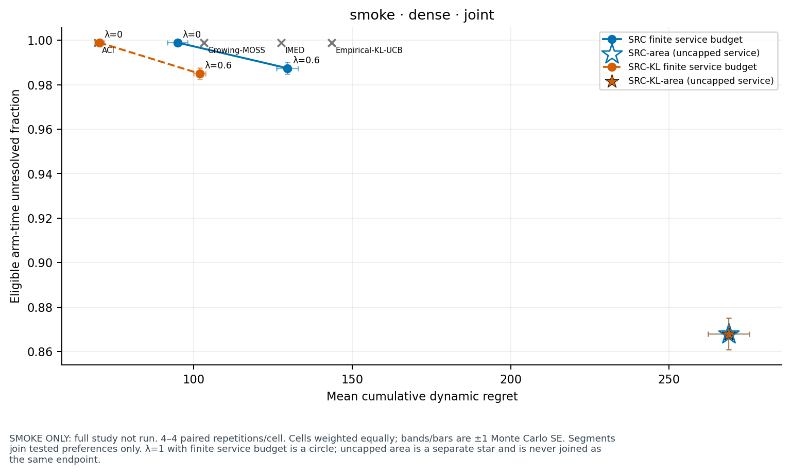
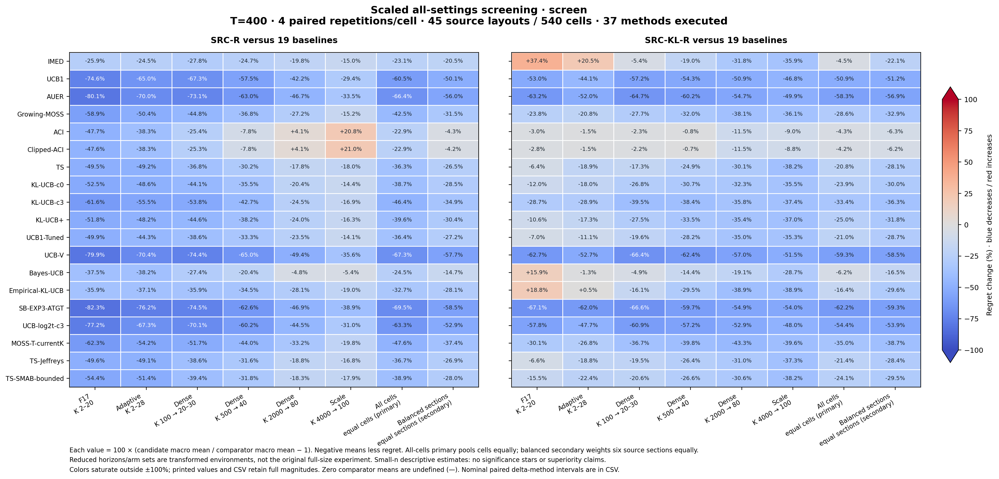

# SRC / SRC-KL 统一数值实验

论文当前无 H8 的 **SRC** 与理论改进版 **SRC-KL** 的最终实现：19 个奖励 baseline、匹配分类调度对照、45 个布局、540 个环境单元，以及统一配对模拟、校验、分析和绘图入口。SRC-KL 保留原经验分布奖励评分，改变 KL/MOSS 切换参考与奖励账本上限。

**完整原规模正式矩阵尚未运行。** 仓库提供两套流程试跑，以及覆盖全部 setting 的缩小预研究入口；缩小后的比较不能代替原规模实验。完整正式入口覆盖 374,496 条唯一轨迹，包含独立尾部研究；复用的奖励端点只执行、计数一次。

本目录只发布最终版本，不保留旧开发代码、调参材料、历史结果或 H8/H16 候选。正常 Git 历史保留，精简来源记录在 `configs/provenance.json`。运行不依赖相邻 `proposal`、Overleaf、WSL 或 C++ 编译器。

## 本机试跑

使用 Python 3.11；已在原生 Windows、Python 3.11.7 验证。首次运行包含 Numba 编译。

```powershell
python -m pip install -r requirements.txt
python run_main.py run --profile smoke-small --output _runs/my-small --workers 1
python run_main.py run --profile smoke-dense --output _runs/my-dense --workers 1
```

每条命令完成模拟、校验、分析和 PNG/PDF/SVG 绘图。打开输出目录的 `analysis/report.html`，图像在 `figures/`，均可离线阅读。输出目录必须为空；再次运行请换目录，或用 `--resume` 续跑同一配置。

| 小实验 | 环境 | 比较内容 | 唯一轨迹 |
| --- | --- | --- | ---: |
| smoke-small | 双臂与少量到达派生布局，T=1000，两种分布，4 次重复 | 两种主算法的奖励端点、偏好 .6、area；全部 19 baseline | 400 |
| smoke-dense | 稳定 incumbent 与晚到记录派生布局，T=800、K=40，两种分布，4 次重复 | 两种主算法的三个模式；IMED、Empirical-KL-UCB、ACI、Growing-MOSS | 160 |

本次完成的结果在 [results/smoke-small](results/smoke-small) 和 [results/smoke-dense](results/smoke-dense)。派生小实验统一标为 smoke，不混入正式矩阵。

下图是密集到达小试验的配对结果，n=4；只作流程和行为检查，不代表完整正式实验结论。实际运行状态见 [STATUS.json](results/STATUS.json)，验收记录见 [VALIDATION.json](results/VALIDATION.json)。



## 全 setting 的缩小比较

需要先比较所有算法在所有 setting 下的表现时，可运行全 setting 缩小研究：

```powershell
python run_main.py run --profile screen-all --dry-run
python run_main.py run --profile screen-all --output _runs/screen-all --workers auto
```

该 profile 为 45 个来源布局 × 对应分布，共 540 cells；T=400、每单元 4 次配对重复，全部 37 个配置，共 79,920 条轨迹。输出 `relative_regret/report.html` 与两种 SRC 对 19 baseline 的相对 regret 热图。原/实际臂数、配对百分比与统计解释见 [SCREENING.md](docs/SCREENING.md)。

本次结果已全部完成：[实际结论](results/screen-all/relative_regret/RESULTS.md)、[完整单元表](results/screen-all/relative_regret/all_cell_methods.csv)、[百分比表](results/screen-all/relative_regret/percent_matrix.csv)。全部 cells 等权时，相对 IMED，SRC-R / SRC-KL-R 的平均 regret 分别降低 23.1% / 4.5%；KL 相对原 SRC 的改善主要出现在高密度与 scale，不能解释成处处更好。



## 完整原规模主实验

```powershell
python run_main.py run --profile full --dry-run
python run_main.py run --profile full --output _runs/main --workers auto
python run_main.py run --profile full --output _runs/main --workers auto --resume
```

`--dry-run` 只打印冻结规模。完整矩阵约有 45 亿次实际拉臂，是长批次任务；不能用首次 JIT 或单次混合负载计时保证完成时间。`auto` 按可用 CPU 和内存选择 worker，上限 8；也可指定 1–64。并行数不改变种子或轨迹。

| 模块 | 布局 × 分布 | 奖励重复数 | 分类重复数 |
| --- | --- | ---: | ---: |
| F17 旧布局 | 12 × 16 | 32 | 8 种分布 × 16 |
| adaptive 新布局 | 12 × 16 | 32 | 8 种分布 × 16 |
| dense | 18 × 8 | 16 | 4 种分布 × 8 |
| scale | 3 × 4 | 8 | 4 种分布 × 8 |
| 独立尾部 | adaptive 中 6 × 2 | 128，四个奖励方法 | 不追加分类 |

原始到达时刻、均值、时域和任务参数均在 `configs/layouts.json`。这是新的统一重复协议，不复用旧算法结果。`full` 已包含尾部研究，也可单独运行 `--profile tail`。

两种主算法各有 reward-only、偏好 .1/.3/.6/.9/1 的有限分类预算模式，以及无限分类预算的 area 模式；奖励系数均为 32，有限分类系数为 1。分类匹配控制是每种算法各自的 widest-interval、LUCB-style，偏好 .6。baseline 的公式、额外信息与别名见 [算法说明](docs/ALGORITHMS.md)。

## 验证与重画

```powershell
python -m pytest -q
python run_main.py verify results/smoke-small --check-current
python run_main.py analyze _runs/my-small
python run_main.py plot _runs/my-small
```

在线 API 为 `Policy.choose(new_arms)`、`observe(reward)`、`report()`；示例见 [ALGORITHMS.md](docs/ALGORITHMS.md)。配对、统计、输出和续跑规则见 [EXPERIMENTS.md](docs/EXPERIMENTS.md)。全部科学失败路径保留；执行异常单独记录，不能视为零成本或从完整结果中悄悄剔除。
