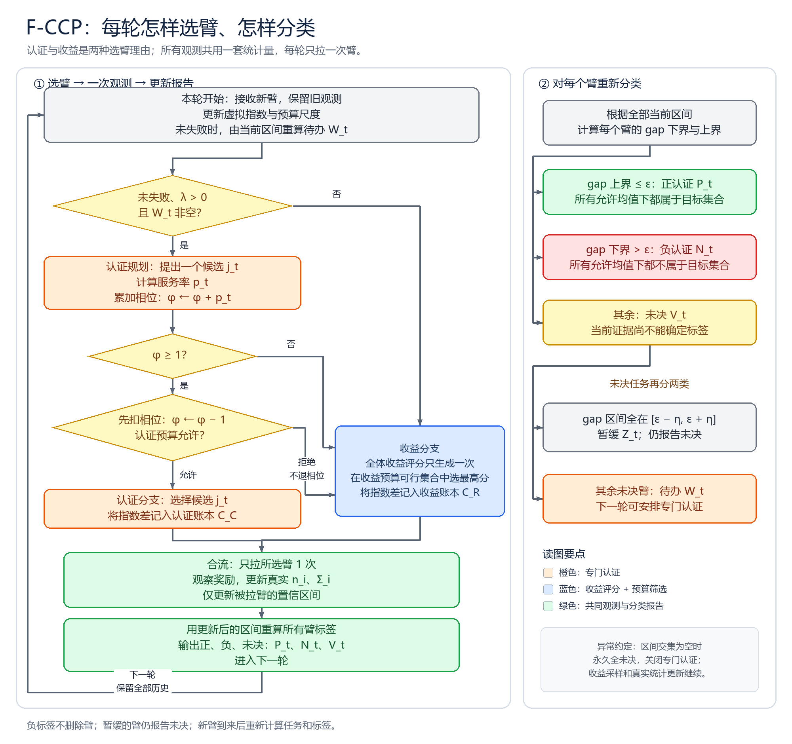
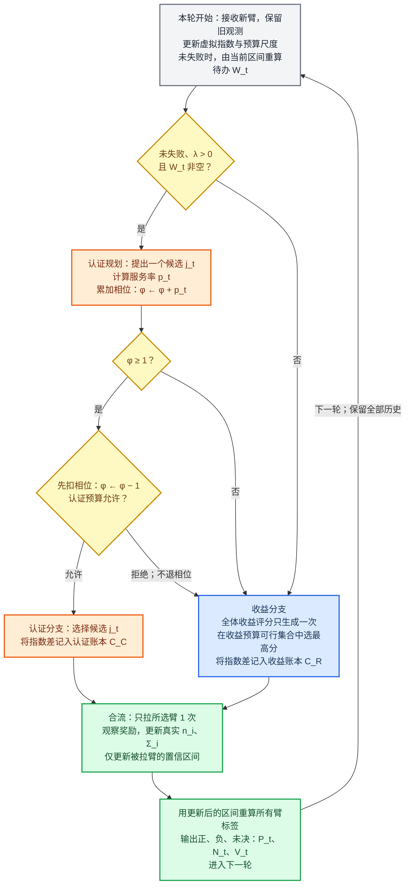
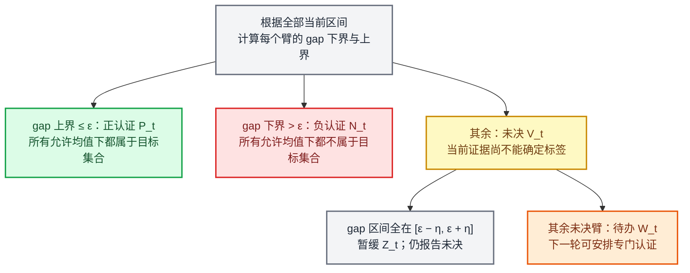

# F-CCP 算法流程图

本图解释当前算法的一轮执行过程。橙色表示专门认证，蓝色表示收益选臂，绿色表示两分支共用的观测与报告。论文、算法和冻结数值结果均未修改。

主流程中，认证提议只是一个候选；只有相位触发且认证预算允许时，才执行认证采样。其余情况都进入收益分支，两个分支最后合并为一次真实观测。

分类规则对每个已到达臂分别计算；更新一只臂的区间，也可能同时改变其他臂的报告。

图中的 gap 上下界为

$$
g_i^- = \max\{0,\max_{j\ne i}\ell_j-u_i\},\qquad
g_i^+ = \max\{0,\max_{j\ne i}u_j-\ell_i\}.
$$

收益分支选择

$$
I_t=\arg\max_{i\in\mathcal F_R(t)}\Xi_i(t),\qquad
\mathcal F_R(t)=\{i:C_R(t-1)+\zeta_t(i)\le\beta_R\overline{\mathcal S}_t\}.
$$

认证提议的预算检查为

$$
C_C(t-1)+\zeta_t(j_t)\le\beta_C\overline{\mathcal S}_t.
$$

在图的认证规划节点内，程序逐个检查待办与参考臂的配对，选择局部规划价格最低的合法配对，再选其中当前最值得补样本的一端。若没有合法配对端点，就选尚未达到检查点的最宽区间。每次只执行一拉，下一轮重新规划。

- 相位决定是否尝试认证；预算决定是否允许执行。被预算拒绝时，相位不退还。
- 两类采样共用真实观测统计量。仅被拉臂的区间更新，但全部已到达臂的标签都重算。
- 负标签不删除臂；新臂可能使旧正标签重新未决。边界带内暂缓的臂仍报告未决。
- 若区间交集为空，程序设置永久失败标志：停止专门认证，所有报告未决；收益采样和真实统计量更新继续。
- 检查点不是开始分类的门槛。达到检查点时加入额外区间，其他轮次也持续更新混合置信证据。

依据：[当前稿件算法](../manuscript.tex)、[交互执行实现](../experiments/fccp_frozen/src/flexible_ccp.py)、[认证规划及服务率](../experiments/fccp_frozen/src/flexible_engine.py)。

`render_flowchart.py` 从本文件的两个 Mermaid 图读取节点文字和有向边，生成便于阅读的合并 PNG/PDF；布局单独固定。运行时检查渲染边与 Mermaid 源一致。
