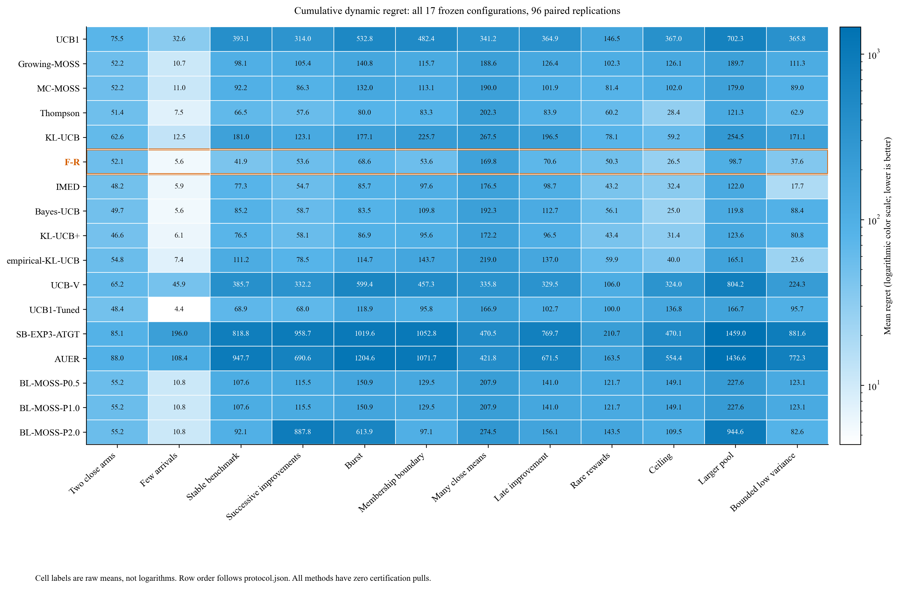
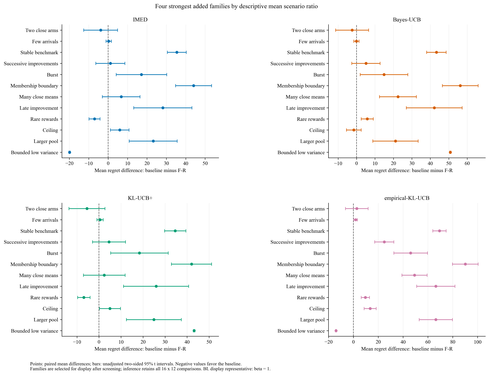

# 独立 regret 基准筛查报告

按场景等权平均比值排序，最低配置是 **F-R**。按原始 regret 的场景等权均值计算，低于 F-R 的其他配置为：无。这些是本组固定环境上的描述性比较，不能推出对任意到达环境的支配关系。

## 实验范围与完整性

本轮只比较 cumulative dynamic regret，目标方法是 F-CCP 的纯收益配置 F-R。全部方法的认证采样次数均为零；没有比较未决面积，也未修改论文。共12个原场景、每场景96个配对重复、17个配置，合计 **19,584次完整运行**。其中包括5个原基准、F-R，以及9个新增算法族；BL-MOSS的3个固定参数配置属于同一算法族。

正式分析已逐格检查 scenario × rep × method 的完整集合、rep=0,...,95、原始T与臂数、真实采样次数、无重复无错误行，以及相同环境与随机数配对。总壁钟时间为2.88分钟；运行环境为Python 3.11.7、NumPy 1.26.4、Numba 0.59.0。

| 场景 | T | 已到达臂数 | 奖励类型 |
| --- | --- | --- | --- |
| Two close arms | 12000 | 2 | bernoulli |
| Few arrivals | 12000 | 3 | bernoulli |
| Stable benchmark | 12000 | 8 | bernoulli |
| Successive improvements | 14000 | 11 | bernoulli |
| Burst | 14000 | 14 | bernoulli |
| Membership boundary | 14000 | 9 | bernoulli |
| Many close means | 12000 | 13 | bernoulli |
| Late improvement | 14000 | 8 | bernoulli |
| Rare rewards | 12000 | 9 | bernoulli |
| Ceiling | 12000 | 9 | bernoulli |
| Larger pool | 16000 | 20 | bernoulli |
| Bounded low variance | 12000 | 10 | two_point |

## 核心比较

下表差值统一为“基准方法减F-R”；负值表示该基准的regret较低。原始regret先对每个场景求96次均值，再对12个场景等权平均。比值则先对各场景计算“方法均值/F-R均值”，再等权平均；两种摘要不能互换。不同场景的T、间隙和奖励分布不同，不把该摘要解释为普遍最优排名。

| 配置 | 场景等权平均 regret (MCSE) | 场景平均比值 / F-R | 平均配对差值 | 平均差值95%区间 | 均值低于F-R场景数 | Bonferroni更低/更高场景数 |
| --- | --- | --- | --- | --- | --- | --- |
| F-R | 60.73 (1.39) | 1.000 | 0.00 | [0.00, 0.00] | 0 | 0 / 0 |
| IMED | 71.67 (0.68) | 1.179 | 10.94 | [8.42, 13.47] | 3 | 2 / 2 |
| Thompson | 75.43 (0.79) | 1.271 | 14.70 | [12.76, 16.63] | 1 | 0 / 6 |
| KL-UCB+ | 76.49 (0.66) | 1.315 | 15.76 | [13.26, 18.26] | 2 | 1 / 4 |
| Bayes-UCB | 82.23 (0.67) | 1.391 | 21.50 | [18.94, 24.05] | 3 | 0 / 5 |
| empirical-KL-UCB | 96.24 (0.67) | 1.590 | 35.50 | [32.85, 38.16] | 1 | 1 / 9 |
| UCB1-Tuned | 97.77 (0.76) | 1.832 | 37.04 | [34.55, 39.53] | 3 | 0 / 8 |
| MC-MOSS | 102.51 (0.98) | 1.919 | 41.78 | [39.47, 44.08] | 0 | 0 / 11 |
| Growing-MOSS | 113.95 (0.58) | 2.168 | 53.22 | [50.63, 55.80] | 0 | 0 / 11 |
| BL-MOSS-P0.5 | 128.32 (0.63) | 2.432 | 67.59 | [64.96, 70.23] | 0 | 0 / 11 |
| BL-MOSS-P1.0 | 128.32 (0.63) | 2.432 | 67.59 | [64.96, 70.23] | 0 | 0 / 11 |
| KL-UCB | 150.74 (0.69) | 2.676 | 90.01 | [87.29, 92.72] | 0 | 0 / 11 |
| BL-MOSS-P2.0 | 288.97 (9.20) | 4.591 | 228.24 | [209.67, 246.82] | 0 | 0 / 11 |
| UCB-V | 334.11 (0.69) | 6.433 | 273.38 | [270.59, 276.18] | 0 | 0 / 11 |
| UCB1 | 343.18 (0.77) | 6.672 | 282.45 | [279.57, 285.34] | 0 | 0 / 12 |
| AUER | 677.59 (0.72) | 13.778 | 616.86 | [613.89, 619.84] | 0 | 0 / 12 |
| SB-EXP3-ATGT | 699.36 (1.00) | 15.190 | 638.63 | [635.39, 641.87] | 0 | 0 / 12 |

MCSE是Monte Carlo标准误。每场景配对差值使用双侧95% Student t区间；同时提供对16个非F-R配置×12个场景、共192项比较的Bonferroni区间。上表最后一列按这一完整比较族统计，未因为展示子集而减少校正范围。平均差值区间属于描述性的总体摘要，使用分层配对方差与保守自由度；它没有对17个总体摘要另做多重校正。

**F-R没有逐场景占优，也没有尾部占优。** 下表列出经完整192项Bonferroni校正后仍低于F-R的配置—场景组合。此外，F-R的各场景95%分位数平均为132.22，IMED为105.95；各场景最差10次均值的平均分别为149.31和109.96。F-R的平均收益优势伴随更大的随机波动，这一点应与平均值一并解释。

| 场景 | 比F-R更低的方法 | 方法均值 | F-R均值 | 配对差值 | Bonferroni 95%区间 |
| --- | --- | --- | --- | --- | --- |
| Rare rewards | IMED | 43.23 | 50.29 | -7.06 | [-12.53, -1.59] |
| Rare rewards | KL-UCB+ | 43.41 | 50.29 | -6.88 | [-12.31, -1.45] |
| Bounded low variance | IMED | 17.72 | 37.61 | -19.88 | [-20.50, -19.27] |
| Bounded low variance | empirical-KL-UCB | 23.61 | 37.61 | -14.00 | [-14.60, -13.41] |

## 全部场景均值与标准误

每格为mean (MCSE)，方法顺序沿用预先冻结的protocol.json。

| 方法 | Two close arms | Few arrivals | Stable benchmark | Successive improvements | Burst | Membership boundary |
| --- | --- | --- | --- | --- | --- | --- |
| UCB1 | 75.52 (1.44) | 32.60 (0.73) | 393.14 (3.63) | 313.99 (2.57) | 532.82 (3.15) | 482.45 (3.95) |
| Growing-MOSS | 52.16 (2.82) | 10.71 (0.40) | 98.11 (1.82) | 105.44 (1.69) | 140.79 (1.77) | 115.74 (2.10) |
| MC-MOSS | 52.16 (2.82) | 11.02 (0.47) | 92.20 (1.71) | 86.29 (2.56) | 131.95 (6.16) | 113.09 (2.11) |
| Thompson | 51.37 (4.71) | 7.47 (0.36) | 66.47 (1.89) | 57.61 (1.54) | 80.01 (3.14) | 83.32 (2.20) |
| KL-UCB | 62.63 (2.09) | 12.52 (0.48) | 181.01 (2.89) | 123.14 (1.82) | 177.09 (2.35) | 225.66 (3.15) |
| F-R | 52.07 (5.77) | 5.63 (0.69) | 41.90 (2.76) | 53.59 (4.00) | 68.56 (6.93) | 53.57 (5.09) |
| IMED | 48.19 (3.48) | 5.91 (0.28) | 77.31 (2.01) | 54.73 (1.28) | 85.72 (1.72) | 97.62 (2.45) |
| Bayes-UCB | 49.66 (3.07) | 5.57 (0.28) | 85.19 (2.36) | 58.69 (1.35) | 83.47 (1.84) | 109.82 (2.78) |
| KL-UCB+ | 46.63 (3.79) | 6.13 (0.27) | 76.50 (1.98) | 58.14 (1.31) | 86.92 (1.64) | 95.57 (2.26) |
| empirical-KL-UCB | 54.83 (2.49) | 7.41 (0.35) | 111.19 (2.49) | 78.48 (1.41) | 114.67 (1.90) | 143.70 (2.96) |
| UCB-V | 65.19 (1.80) | 45.86 (0.73) | 385.71 (3.02) | 332.16 (2.20) | 599.39 (2.71) | 457.25 (3.04) |
| UCB1-Tuned | 48.39 (4.04) | 4.39 (0.27) | 68.94 (2.31) | 68.01 (1.52) | 118.87 (2.28) | 95.80 (2.70) |
| SB-EXP3-ATGT | 85.14 (1.76) | 196.01 (1.99) | 818.80 (4.74) | 958.71 (5.11) | 1019.55 (3.50) | 1052.75 (4.64) |
| AUER | 88.04 (0.80) | 108.44 (1.28) | 947.70 (3.84) | 690.58 (2.83) | 1204.60 (3.22) | 1071.72 (3.95) |
| BL-MOSS-P0.5 | 55.17 (2.63) | 10.82 (0.40) | 107.58 (1.89) | 115.47 (1.74) | 150.89 (1.99) | 129.55 (2.39) |
| BL-MOSS-P1.0 | 55.17 (2.63) | 10.82 (0.40) | 107.58 (1.89) | 115.47 (1.74) | 150.89 (1.99) | 129.55 (2.39) |
| BL-MOSS-P2.0 | 55.17 (2.63) | 10.82 (0.40) | 92.10 (1.75) | 887.84 (62.43) | 613.90 (78.06) | 97.05 (2.13) |

| 方法 | Many close means | Late improvement | Rare rewards | Ceiling | Larger pool | Bounded low variance |
| --- | --- | --- | --- | --- | --- | --- |
| UCB1 | 341.20 (2.40) | 364.87 (3.92) | 146.50 (0.40) | 366.96 (1.70) | 702.32 (3.76) | 365.81 (0.25) |
| Growing-MOSS | 188.60 (3.68) | 126.45 (2.35) | 102.35 (0.96) | 126.06 (1.32) | 189.70 (2.39) | 111.25 (0.17) |
| MC-MOSS | 190.01 (4.97) | 101.93 (2.19) | 81.43 (1.33) | 102.01 (1.53) | 179.02 (6.66) | 88.96 (0.13) |
| Thompson | 202.27 (4.22) | 83.89 (2.94) | 60.16 (1.50) | 28.42 (1.14) | 121.25 (4.10) | 62.89 (0.22) |
| KL-UCB | 267.46 (3.28) | 196.49 (3.53) | 78.06 (0.99) | 59.24 (1.24) | 254.50 (3.18) | 171.08 (0.24) |
| F-R | 169.80 (5.71) | 70.56 (7.70) | 50.29 (1.77) | 26.46 (2.44) | 98.74 (6.89) | 37.61 (0.17) |
| IMED | 176.54 (4.50) | 98.74 (3.44) | 43.23 (1.32) | 32.41 (0.90) | 121.96 (2.43) | 17.72 (0.04) |
| Bayes-UCB | 192.26 (3.94) | 112.71 (3.59) | 56.10 (1.07) | 24.98 (0.99) | 119.83 (2.56) | 88.44 (0.22) |
| KL-UCB+ | 172.20 (3.84) | 96.50 (3.40) | 43.41 (1.26) | 31.44 (0.85) | 123.64 (2.29) | 80.79 (0.20) |
| empirical-KL-UCB | 219.00 (3.80) | 136.95 (3.51) | 59.93 (1.07) | 39.96 (1.01) | 165.10 (2.86) | 23.61 (0.05) |
| UCB-V | 335.85 (2.42) | 329.51 (3.51) | 105.96 (0.78) | 324.00 (1.45) | 804.18 (3.59) | 224.29 (0.17) |
| UCB1-Tuned | 166.90 (4.47) | 102.73 (3.65) | 100.03 (0.81) | 136.83 (1.64) | 166.72 (3.15) | 95.66 (0.19) |
| SB-EXP3-ATGT | 470.48 (2.14) | 769.66 (5.32) | 210.65 (1.13) | 470.07 (1.23) | 1458.99 (4.02) | 881.56 (1.54) |
| AUER | 421.80 (1.22) | 671.46 (3.07) | 163.51 (0.26) | 554.36 (1.35) | 1436.61 (3.33) | 772.31 (0.29) |
| BL-MOSS-P0.5 | 207.89 (3.80) | 141.01 (2.92) | 121.75 (1.06) | 149.05 (1.39) | 227.61 (2.89) | 123.12 (0.18) |
| BL-MOSS-P1.0 | 207.89 (3.80) | 141.01 (2.92) | 121.75 (1.06) | 149.05 (1.39) | 227.61 (2.89) | 123.12 (0.18) |
| BL-MOSS-P2.0 | 274.47 (10.38) | 156.10 (6.70) | 143.53 (1.49) | 109.50 (1.25) | 944.64 (45.00) | 82.56 (0.15) |

## 尾部表现

| 配置 | 各场景95%分位数的平均 | 各场景最差10次均值的平均 | 全部1152次最大regret |
| --- | --- | --- | --- |
| UCB1 | 381.69 | 384.37 | 781.70 |
| Growing-MOSS | 143.26 | 146.36 | 297.02 |
| MC-MOSS | 148.84 | 158.48 | 443.93 |
| Thompson | 114.70 | 122.93 | 319.96 |
| KL-UCB | 184.55 | 188.59 | 358.47 |
| F-R | 132.22 | 149.31 | 677.65 |
| IMED | 105.95 | 109.96 | 342.42 |
| Bayes-UCB | 117.20 | 119.76 | 299.47 |
| KL-UCB+ | 109.68 | 113.16 | 276.35 |
| empirical-KL-UCB | 129.18 | 132.16 | 324.32 |
| UCB-V | 369.63 | 372.42 | 892.45 |
| UCB1-Tuned | 135.40 | 140.98 | 314.82 |
| SB-EXP3-ATGT | 750.90 | 756.84 | 1551.05 |
| AUER | 713.15 | 714.25 | 1512.71 |
| BL-MOSS-P0.5 | 161.34 | 163.87 | 312.62 |
| BL-MOSS-P1.0 | 161.34 | 163.87 | 312.62 |
| BL-MOSS-P2.0 | 585.29 | 585.39 | 2945.15 |

每个场景只有96次重复，95%分位数是样本分位数；“最差10次”取该场景96次结果中最大的10个。上述量用于发现偶发高regret，不能作为尾概率保证。完整逐场景分位数、最大值和未采样臂数保留在summary.csv，逐次结果保留在runs-all.csv。

## 与原冻结实验的对应

6个参考方法的全部6912个重跑终点均在1e-9容差内吻合原冻结结果。

| 原参考方法 | 核对次数 | 最大绝对差 | 绝对差大于1e-9次数 |
| --- | --- | --- | --- |
| F-R | 1152 | 5.68e-14 | 0 |
| Growing-MOSS | 1152 | 8.53e-14 | 0 |
| KL-UCB | 1152 | 8.53e-14 | 0 |
| MC-MOSS | 1152 | 8.53e-14 | 0 |
| Thompson | 1152 | 5.68e-14 | 0 |
| UCB1 | 1152 | 5.68e-14 | 0 |

在扩展实验之前，已对12个场景×6个原参考方法的第0次重复、完整T，核验省略报告计算后的runner与原production simulate_dual：逐次动作、终点计数、真实统计量、regret路径和预算账本一致。此次比较仍重新运行全部原参考方法，不从旧表直接拼接新方法结果。

## 配对、随机种子与参数

奖励种子基数是117110100，策略种子基数是117120100。第s个场景、第r次重复的奖励和策略种子分别加上10000*s+r。批内均值置换使用奖励种子基数+50000000+10000*s+r。每个scenario-rep只生成一次完整的“臂×原始T”潜在奖励矩阵，所有方法读取同一矩阵，每个臂按自己的累计拉取次数索引。共享的是潜在奖励流；随机算法共享数值种子不意味着相同随机动作。

原Bernoulli和two-point生成机制、全部均值、到达时刻、批内置换均未改变。所有方法只看到既有观测、当前时刻和已到达臂的信息；BL-MOSS另知T和固定假设beta，信息差已明示。没有按本轮性能调整参数或只保留较好的BL版本。

| 配置 | 算法族 | 固定参数 | 决策信息 |
| --- | --- | --- | --- |
| UCB1 | 原冻结参考规则 | 沿用holdout-freeze.json | Original current-history-only production rule |
| Growing-MOSS | 原冻结参考规则 | 沿用holdout-freeze.json | Original current-history-only production rule |
| MC-MOSS | 原冻结参考规则 | 沿用holdout-freeze.json | Original current-history-only production rule |
| Thompson | 原冻结参考规则 | 沿用holdout-freeze.json | Original current-history-only production rule |
| KL-UCB | 原冻结参考规则 | 沿用holdout-freeze.json | Original current-history-only production rule |
| F-R | 原冻结参考规则 | 沿用holdout-freeze.json | Original current-history-only production rule |
| IMED | IMED-bounded | p0=0.0, p1=0.0, p2=0.0 | Observed history and current availability only; no horizon or final arm count |
| Bayes-UCB | Bayes-UCB | p0=0.0, p1=0.0, p2=0.0 | Observed history and current availability only; no horizon or final arm count |
| KL-UCB+ | KL-UCB+ | p0=0.0, p1=0.0, p2=0.0 | Observed history and current availability only; no horizon or final arm count |
| empirical-KL-UCB | empirical-KL-UCB | p0=0.0, p1=0.0, p2=0.0 | Observed history and current availability only; no horizon or final arm count |
| UCB-V | UCB-V | p0=0.0, p1=0.0, p2=0.0 | Observed history and current availability only; no horizon or final arm count |
| UCB1-Tuned | UCB1-Tuned | p0=0.0, p1=0.0, p2=0.0 | Observed history and current availability only; no horizon or final arm count |
| SB-EXP3-ATGT | SB-EXP3-ATGT | p0=0.0, p1=0.0, p2=0.0 | Observed history and current availability only; no horizon or final arm count |
| AUER | AUER | p0=0.0, p1=0.0, p2=0.0 | Observed history and current availability only; no horizon or final arm count |
| BL-MOSS-P0.5 | BL-MOSS-countcap-P | p0=0.5, p1=0.0, p2=T | Knows horizon T and fixed assumed Pareto exponent beta; no means, future births or final arm count |
| BL-MOSS-P1.0 | BL-MOSS-countcap-P | p0=1.0, p1=0.0, p2=T | Knows horizon T and fixed assumed Pareto exponent beta; no means, future births or final arm count |
| BL-MOSS-P2.0 | BL-MOSS-countcap-P | p0=2.0, p1=0.0, p2=T | Knows horizon T and fixed assumed Pareto exponent beta; no means, future births or final arm count |

### BL-MOSS参数版本的关系

BL-MOSS接受上限为ceil(T^(1/(1+2*beta)))。

| 场景 | T | 总臂数 | beta=.5 接受上限 | beta=1 接受上限 | beta=2 接受上限 |
| --- | --- | --- | --- | --- | --- |
| Two close arms | 12000 | 2 | 110 | 23 | 7 |
| Few arrivals | 12000 | 3 | 110 | 23 | 7 |
| Stable benchmark | 12000 | 8 | 110 | 23 | 7 |
| Successive improvements | 14000 | 11 | 119 | 25 | 7 |
| Burst | 14000 | 14 | 119 | 25 | 7 |
| Membership boundary | 14000 | 9 | 119 | 25 | 7 |
| Many close means | 12000 | 13 | 110 | 23 | 7 |
| Late improvement | 14000 | 8 | 119 | 25 | 7 |
| Rare rewards | 12000 | 9 | 110 | 23 | 7 |
| Ceiling | 12000 | 9 | 110 | 23 | 7 |
| Larger pool | 16000 | 20 | 127 | 26 | 7 |
| Bounded low variance | 12000 | 10 | 110 | 23 | 7 |

beta=.5 与 beta=1 的全部1152组动作哈希完全一致。 在本组小臂池中，beta=.5和beta=1的接受上限均超过最终臂数，均退化为接受全部已到达臂的同一已知T-MOSS规则。它们不算两份独立证据。beta=2的上限为7，会拒绝后续到达序号超过上限的臂。保留3版用于说明这一敏感性，不能事后选择最有利参数作为BL-MOSS唯一结果。

## 图形

图1色阶采用对数尺度，格内数字是原始regret均值。橙色框标出F-R，所有配置均保留。

图2展示按场景平均比值选择的4个新增算法族：IMED、Bayes-UCB、KL-UCB+、empirical-KL-UCB。这是结果后的展示筛选，不是新的检验集合；BL若入选，固定使用beta=1作为展示代表。误差线为每场景未校正95%配对区间，192项比较的Bonferroni结论仍以完整paired-vs-FR.csv为准。两图同时提供矢量PDF和300dpi PNG。

## 理论适用边界与结论范围

- 当前availability只增不减，是sleeping bandit的特殊可用集合。一般sleeping算法在此可以运行，但其逐臂sleeping comparator不等于本文每时刻最好已到达臂的dynamic comparator；不能直接移植regret上界。
- AUER与原UCB1属于同一UCB类，区别包括原文探索常数。本轮新增的是忠实对照配置，不能把它视为另一项方法创新。
- BL-MOSS原分析含到达尾部及逐轮到达假设。本轮采用明示的批量到达序号截断适配，beta=.5、1、2只是事先固定的假设值，不是这些确定性场景已满足的真实尾指数。已知T也是额外信息。
- IMED和empirical-KL-UCB按实际观测support计算有界分布Dinf；本套每臂最多两点支持，当前精确实现专用于这一条件，不应宣称支持任意多点奖励分布。
- Bayes-UCB及原TS在Bernoulli场景按Beta更新；在有界非Bernoulli场景使用分数计数只是明示的采样适配，不宣称其为正确Bernoulli后验。UCB-V采用原论文实验参数，不能援引要求严格大于1的探索常数条件。
- 本次是对已经查看过的原测试集进行回顾性筛查，新增规则和参数在新性能运行前冻结，仍不构成新的独立holdout。配对区间反映给定场景的Monte Carlo不确定性，不覆盖场景选择或方法展示选择。

### 固定实现约定

- **IMED**：Honda and Takemura 2015 Algorithm1; empirical Dinf on [0,1]; initially pull each arrived arm once. Exact one/two-observed-support implementation for this suite, no true support input.

- **Bayes-UCB**：Kaufmann et al. 2012 Algorithm1, independent uniform Beta(1,1), c=0, quantile 1-1/t. No forced initialization. Fractional-count heuristic on the non-Bernoulli scenario, same convention as existing TS; no valid Bernoulli posterior claim there.

- **KL-UCB+**：Bernoulli KL, n*kl(mean,q)<=log(t/n), c=0, 32 bisection steps, initialize arrived arms once. Bounded-reward mean-based adaptation.

- **empirical-KL-UCB**：Cappe et al. 2013 empirical-distribution upper confidence index; n*Dinf(Fhat,q)<=log(t), c=0 empirical choice discussed by Honda2015. Initialize arrived arms once; exact observed two-support computation.

- **UCB-V**：Audibert et al. 2009 Eq18 with variance divisor n, zeta=1,c=1,b=1, their experimental prescription; not a claim that zeta>1 theorem applies.

- **UCB1-Tuned**：Auer et al. 2002 variance-adaptive heuristic, variance divisor n, standard min(1/4,V+sqrt(2logt/n)) factor.

- **AUER**：Kleinberg et al. 2008 Algorithm2, mean+sqrt(8logt/n). Same family as existing UCB1 but original published exploration constant; preserve all history.

- **SB-EXP3-ATGT**：Nguyen and Mehta 2024 Algorithm5, gamma=0, two-level doubling, exact sleeping regret update. No final K or T. Its published per-action sleeping comparator differs from this study current-best dynamic comparator.

- **BL-MOSS**：Ghalme et al. 2021 Algorithm1/prose adaptation to batches: accept first ceil(T^(1/(1+2beta))) arriving labels, run current-accepted-K MOSS with known T, retain old data. beta=.5,1,2 are assumed sensitivity values, not fitted true arrival-tail parameters. Original one-new-arm-per-round/theoretical tail assumptions are not asserted.

### 原始算法来源

- [IMED 原文](https://jmlr.org/papers/volume16/honda15a/honda15a.pdf)

- [Bayes-UCB 原文](https://proceedings.mlr.press/v22/kaufmann12/kaufmann12.pdf)

- [KL-UCB+ 原文](https://arxiv.org/pdf/1102.2490)

- [empirical-KL-UCB 原文](https://arxiv.org/pdf/1210.1136)

- [UCB-V 原文](https://www.ualberta.ca/~szepesva/papers/ucbtuned-journal.pdf)

- [AUER 原文](https://www.cs.cornell.edu/~rdk/papers/colt08.pdf)

- [SB-EXP3-ATGT 原文](https://proceedings.mlr.press/v238/nguyen24d/nguyen24d.pdf)

- [BL-MOSS 原文](https://research.chalmers.se/publication/522732/file/522732_Fulltext.pdf)

## 复核与复现文件

- protocol.json：事前冻结的场景来源、17个配置、参数、信息条件和来源链接。
- runner.py、new_policies.py、sb_exp3.py：冻结执行入口及算法实现。
- results/run-info.json、settings-audit.json：完整运行、环境与原设置记录。
- results/runs-all.csv、runs-00.csv至runs-11.csv：所有逐次regret、计数、潜在流哈希和动作哈希。
- results/summary.csv、paired-vs-FR.csv、suite-summary.csv、historical-reference-check.csv：全部描述统计、配对区间和原结果核对。
- results/paths-00.npz至paths-11.npz：每方法前4次重复、每200轮记录的regret路径。
- audit/reference-equivalence.json、analysis-synthetic-check.json：原选择等价核验及独立分析器合成测试。
- analyze.py、report_results.py：完成矩阵的分析和本报告/图形生成器。

在本目录运行：`python analyze.py results --protocol protocol.json`，随后`python report_results.py results --protocol protocol.json`。完整实验入口为`python runner.py --protocol protocol.json --output results-new --workers 8`；请使用新的输出目录保存独立重跑，避免覆盖本次结果。

协议SHA256：`4871244eacb3e074bf4fbc78c715379a37b3de9dd43d2ccce9bab4f4c4c2b509`。冻结运行源payload SHA256：`ef598f153f9533b35d3b24a0a29d5678123c932652208f47a5e7a505e51e0501`。
