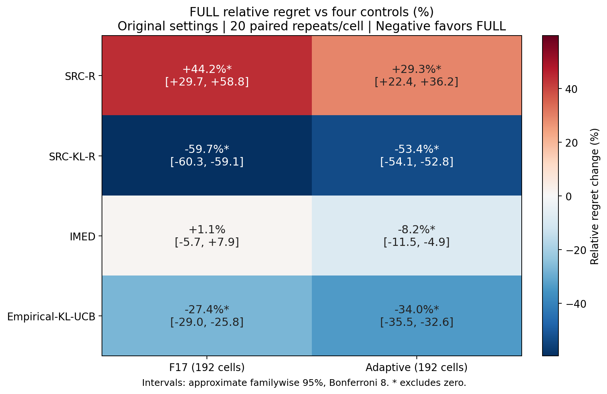
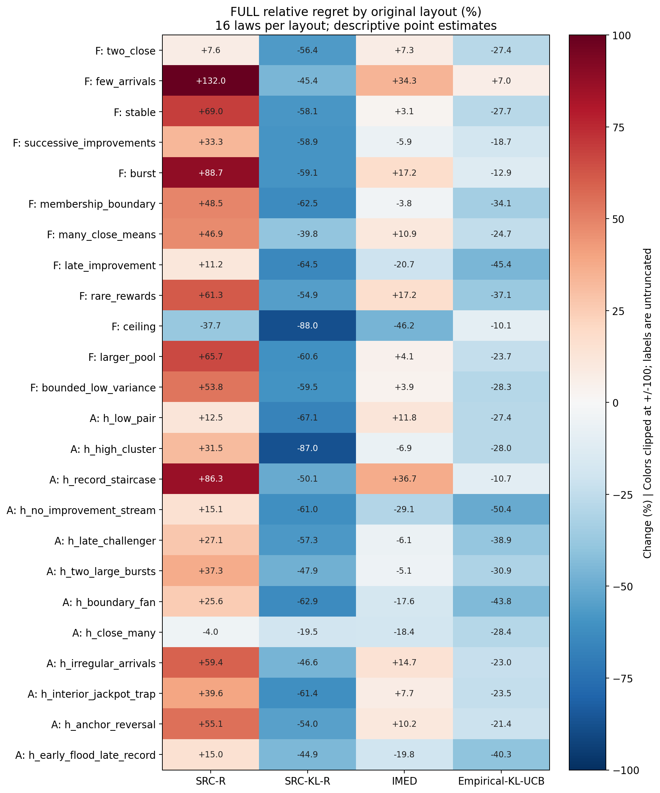

# 简化稿 FULL 的原尺寸奖励比较：实际结论

**FULL 明显改善了默认 SRC-KL 和 Empirical-KL-UCB 的平均 regret；它在 adaptive 中优于 IMED，但没有超过原 SRC。** F17 中 FULL 与 IMED 的总体差异尚不能确认。这里的 FULL 是简化稿算法的 OFF 纯奖励模式，没有根据本次结果调整参数。

## 实验范围与平均 regret

F17、adaptive 各 12 个原始布局 × 16 种分布，共 384 单元，每单元 20 次新配对重复。原来的时域、臂数、均值、到达时刻和分布参数均保留。各单元等权，每组有 3,840 个配对世界；共 38,400 条方法轨迹。数值越小越好。

| 方法 | F17 平均 regret | adaptive 平均 regret |
| --- | ---: | ---: |
| 原 SRC-R | 25.3931 | 41.2285 |
| 简化稿 FULL-R | 36.6277 | 53.3176 |
| 默认 SRC-KL-R | 90.9208 | 114.4747 |
| IMED | 36.2313 | 58.0782 |
| Empirical-KL-UCB | 50.4468 | 80.8367 |

SRC 与 SRC-KL 使用正式默认参数，包括奖励预算系数 32、奖励评分 log 系数 0.5、SRC-KL cap 系数 1。本次没有使用先前的 cap 系数 8192 调参候选。因此，不能把这次相对默认 SRC-KL 的改善解读成对该调参候选的改善。

## FULL 相对各对照的变化

百分比为 100 ×（FULL 的单元等权平均 regret − 对照的单元等权平均 regret）/ 对照的单元等权平均 regret；负值表示 FULL 更好。这是宏观均值的比值，不是各单元百分比的平均。

| 对照 | F17 相对变化；校正区间 | adaptive 相对变化；校正区间 |
| --- | ---: | ---: |
| SRC-R | +44.24%；[+29.70, +58.78]% | +29.32%；[+22.40, +36.25]% |
| SRC-KL-R | −59.71%；[−60.32, −59.11]% | −53.42%；[−54.09, −52.76]% |
| IMED | +1.09%；[−5.67, +7.86]% | −8.20%；[−11.49, −4.90]% |
| Empirical-KL-UCB | −27.39%；[−28.96, −25.83]% | −34.04%；[−35.49, −32.59]% |

八个主要比较在运行前冻结。区间使用分层配对 Monte Carlo 方差、保留配对协方差的 delta method、Satterthwaite t 近似及 Bonferroni 校正，目标为近似整体 95% 覆盖。它们描述这一固定测试矩阵的采样误差，不能视为对任意环境的优越性保证。

## 优势是否遍及每个 setting

没有。下表是每组 192 单元中 FULL 的样本平均 regret 较低、较高、持平的数量；这是点估计计数，不是显著性检验计数。

| 组别 | 对照 | 较低 | 较高 | 持平 |
| --- | --- | ---: | ---: | ---: |
| F17 | SRC-R | 8 | 184 | 0 |
| F17 | SRC-KL-R | 192 | 0 | 0 |
| F17 | IMED | 46 | 146 | 0 |
| F17 | Empirical-KL-UCB | 165 | 25 | 2 |
| adaptive | SRC-R | 24 | 168 | 0 |
| adaptive | SRC-KL-R | 191 | 1 | 0 |
| adaptive | IMED | 95 | 96 | 1 |
| adaptive | Empirical-KL-UCB | 174 | 18 | 0 |

按布局汇总 16 种分布时，FULL 相对 IMED 在 F17 的晚到改进 `late_improvement` 中降低 20.7%，在少量到达 `few_arrivals` 中反而增加 34.3%；在 adaptive 的无改进到达流 `h_no_improvement_stream` 中降低 29.1%，在逐次刷新最优值的 `h_record_staircase` 中增加 36.7%。这些是探索性点估计，完整布局和单元结果均保留，没有仅挑选有利场景。

adaptive 中相对 IMED 的总体改善与逐单元胜负大致各半并不矛盾：总体均值取决于 regret 差的大小，优胜计数只记录正负。当前结果支持“部分环境有收益”，不支持“逐环境支配”。

全部 384 个布局—分布组合见[单元热图](../figures/relative_regret_by_cell.png)及[完整探索性统计表](exploratory_comparisons.csv)；五个方法的全过程见[regret 轨迹](../figures/regret_trajectories.png)。

## 实现、运行与证据边界

实现包含简化稿的 FULL、GT_M 报告器及 ON 服务门控；本次只运行 OFF 纯奖励比较。所有方法关闭被动报告计算，并通过开启/关闭报告的动作一致性测试。因此，本批不提供分类可靠性、未决面积或 ON 性能结论，也不以普通浮点实现声称认证区间运算。

原生 Windows、16 个 worker 的记录计算时间约 7.01 小时；其中发生一次清单文件原子替换的访问错误。错误发生时的 1,171 个完成分片全部按原字节保留，使用相同源码、配置和种子恢复后完成全部 7,680 个世界。该错误及恢复记录见[执行事件](../validation/execution_incidents.json)。483,200,000 次反馈是最终纳入的唯一轨迹总量；中断时在途任务的重算不增加样本数。

193 项仓库测试通过；完整原始数据重建、配对、源码快照和八个主比较的独立数值核验通过。证据见[测试记录](../validation/tests.json)和[独立数值核验](independent_verification.json)。本批与旧参数检查、缩小实验及简化稿引用的其他种子批次分开报告，没有混合样本。

重现命令、算法公式和统计规则见[简化算法使用说明](../../../docs/SIMPLIFIED.md)。原始数据、源码快照及每个世界的分片都在本结果目录；完整 45 布局、540 单元的旧主协议仍未运行。
