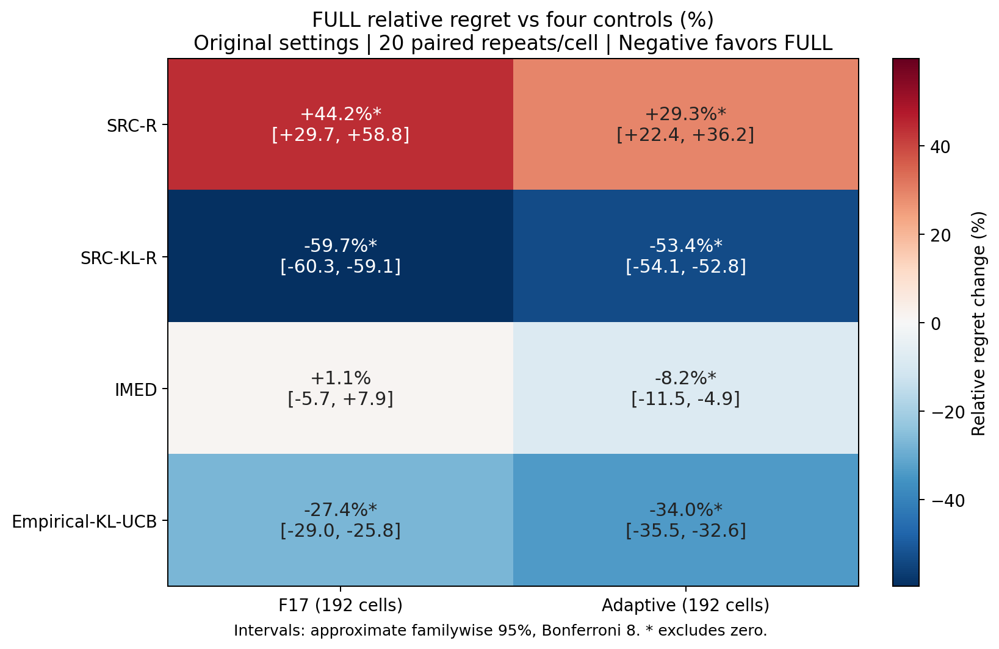

# FULL 原尺寸纯奖励配对实验

F17 与 adaptive 各 12 布局、16 分布，每单元 20 次新配对重复，共 7680 个世界、38400 条轨迹。时域、臂数、到达、均值及分布参数均为原始设置。

SRC-R、SRC-KL-R 沿用正式默认参数；未采用此前调参候选。所有方法共享按臂的观察次数索引的潜在奖励与同批标签置换。没有参数搜索或依照结果提前停止。

只比较动态 pseudo-regret。被动报告计算对所有方法关闭；本实验不报告分类可靠性或未决面积。

## 主要比较

百分比 = 100 ×（FULL 平均 regret − 对照平均 regret）/ 对照平均 regret。负值有利于 FULL。单元等权；八个主比较共同采用 Bonferroni 95% 校正，百分比区间使用保留配对协方差的 delta method。

| 组别 | 对照 | FULL regret | 对照 regret | 相对变化 | 校正区间 |
|---|---|---:|---:|---:|---:|
| f17 | SRC-R | 36.6277 | 25.3931 | +44.24% | [+29.70, +58.78]% |
| f17 | SRC-KL-R | 36.6277 | 90.9208 | -59.71% | [-60.32, -59.11]% |
| f17 | IMED | 36.6277 | 36.2313 | +1.09% | [-5.67, +7.86]% |
| f17 | Empirical-KL-UCB | 36.6277 | 50.4468 | -27.39% | [-28.96, -25.83]% |
| adaptive | SRC-R | 53.3176 | 41.2285 | +29.32% | [+22.40, +36.25]% |
| adaptive | SRC-KL-R | 53.3176 | 114.4747 | -53.42% | [-54.09, -52.76]% |
| adaptive | IMED | 53.3176 | 58.0782 | -8.20% | [-11.49, -4.90]% |
| adaptive | Empirical-KL-UCB | 53.3176 | 80.8367 | -34.04% | [-35.49, -32.59]% |

逐布局、逐分布及全部 384 单元结果见 exploratory_comparisons.csv；其区间为未作多重校正的探索性区间。总体均值优势不意味着逐单元支配。区间只描述固定测试矩阵的 Monte Carlo 误差。

所有原始路径保留。最大观察 regret 属于样本诊断，不是尾部概率保证。该批种子与简化稿所引用的 32 次 adaptive 实验不同，未合并为同一批样本。
