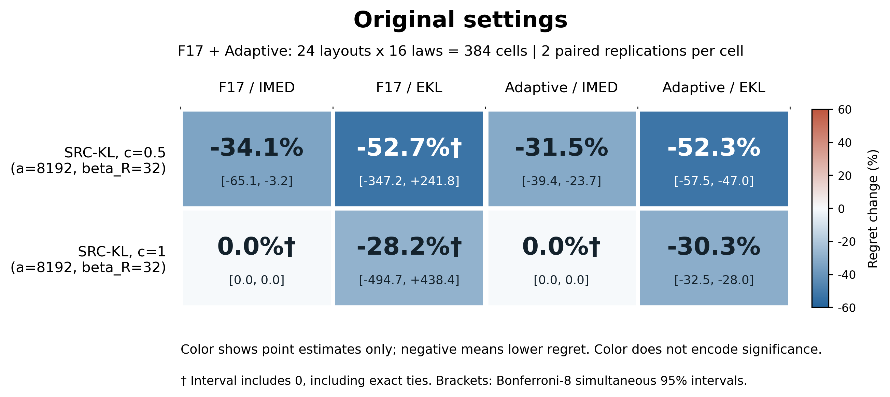
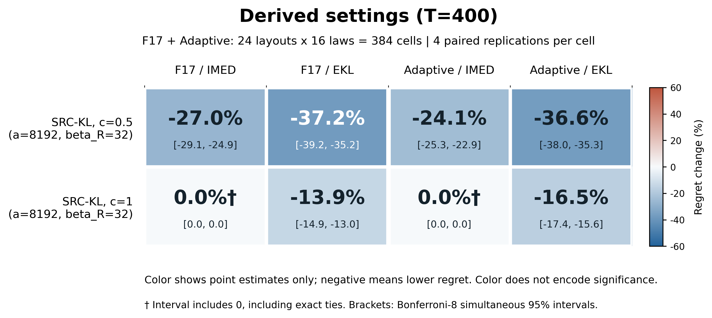

# SRC-KL 固定参数检查

本轮保持算法结构、到达时钟、KL/MOSS 切换、完整经验分布、双账本和分类机制不变，仅比较固定奖励预算/评分系数。所有配置均为 reward-only，$\lambda=0$；没有加入 H8。默认算法参数未被此次检查自动替换。

## 两个事先冻结的候选

奖励预算为

$$
B_R(t)=\min\{32\overline S_t,\;a\sqrt{\log(e+t)}\}.
$$

奖励选择在可行集合内最小化 $n_iD_{\inf}(\widehat F_i,\widehat\mu_{\max})+c\log n_i$，未观察臂优先。

| 配置 | 上限系数 a | 评分系数 c | 奖励系数 |
| --- | ---: | ---: | ---: |
| 默认 SRC-KL-R | 1 | 0.5 | 32 |
| 候选 A：只放宽预算 | 8192 | 0.5 | 32 |
| 候选 B：同时调整评分 | 8192 | 1 | 32 |

开发在 12 个原尺寸布局 × 4 种代表性分布、每单元 2 次配对重复上进行，比较预先冻结的 25 个配置；按两个大类对 IMED/Empirical-KL-UCB 的四个宏均值比的最差项选参。两条路线（只调预算、联合调参）均在读取验证结果前固定，验证后不再重新选参；没有按每个 setting 选择参数。开发单元与完整验证的分布权重不同。

## 原尺寸验证

使用全部 F17/adaptive 的 24 个原布局 × 16 种分布，共 384 个单元，每单元 2 次配对重复、6 个配置，共 4,608 条轨迹。保留原时域（8,000–16,000）、原臂数、原到达、均值和任务参数，验证种子为 2026110119。没有运行原尺寸 20 次重复批次。

| 方法 | F17 平均 regret | adaptive 平均 regret |
| --- | ---: | ---: |
| 默认 SRC-KL | 91.007 | 112.800 |
| 候选 A | 23.675 | 37.787 |
| 候选 B | 35.937 | 55.169 |
| 原 SRC | 23.675 | 37.787 |
| IMED | 35.937 | 55.169 |
| Empirical-KL-UCB | 50.037 | 79.139 |

候选 A 的原尺寸配对结果如下。区间为固定单元等权的分层 Monte Carlo 差值区间，使用 Satterthwaite t 近似，并对两个候选 × 两个大类 × 两个 baseline 的 8 项比较作 Bonferroni 校正。区间反映固定矩阵上的模拟噪声，不是对未知环境总体的保证。

| 大类 | 对照 | 平均 regret 变化 | 配对差值的 95% 家族校正区间 | 支持严格改善 |
| --- | --- | ---: | ---: | --- |
| f17 | IMED | -34.12% | [-15.901, -8.625] | 是 |
| f17 | Empirical-KL-UCB | -52.69% | [-155.494, +102.769] | 尚不能确认 |
| adaptive | IMED | -31.51% | [-21.829, -12.937] | 是 |
| adaptive | Empirical-KL-UCB | -52.25% | [-46.005, -36.699] | 是 |



候选 A 的四个点平均值均更低，但只有三项校正区间低于 0；F17/Empirical-KL-UCB 的自由度约 1.218，区间很宽，不能宣称四项同时显著改善。线性化百分比区间可能超出 -100%，未作人为截断；原始值与区间见 [配对表](original-validation/parameter_analysis/paired_contrasts.csv)。每单元仅 2 次重复，此处是探索性检查。

候选 B 与 IMED 的 768 条完整选臂轨迹及 regret 完全相同，奖励 guard 未改变动作。候选 A 与原 SRC 的 765/768 条轨迹相同；其余 3 条均在 F17 的 two_close/rep0，Bernoulli 与双端点分布的 regret 分别相差 -0.017、+0.017，宏平均相抵；截断正态的 regret 相同。不能说这两个算法在一般情形下完全等价，也不能把这些结果解释为 KL 参考带来的额外数值优势。

## 派生小规模压力检查

另用新种子 2026110118 跑完全部 540 个派生单元，T=400、每单元 4 次配对重复，共 12,960 条轨迹。F17/adaptive 的候选 A 对 IMED 分别降低 27.03%/24.10%，对 Empirical-KL-UCB 降低 37.20%/36.63%，四个校正区间均低于 0；两候选在本轮分别与原 SRC/IMED 的全部 2,160 条轨迹相同。



候选 A 在 scale 派生组相对默认 SRC-KL 的平均 regret 增加 32.75%；因此不能把这组参数当作所有到达规模的全面升级，或把缩小结果当成原 K=4000 的测量。完整压力检查见 [分组表](scaled-validation/parameter_analysis/group_methods.csv)。

## 解释与复现

固定正系数 $a$ 仍满足 $a\sqrt{\log(e+t)}=o(\log t)$，符合理论说明中的次对数预算条件；这不保证更小的有限时域 regret。较大的上限会使次对数约束在当前时域内不绑定，但谱预算仍存在。候选 A 保留原评分系数，候选 B 则只作为评分系数对照；没有用数值曲线代替理论证明，也未检验这两组新参数的完整正分类偏好曲线。

所有算法共享每臂按观测次数索引的潜在奖励流与同批标签置换，评价器保存真实均值与未来到达。原尺寸 15 条、派生检查 18 条 coverage 标记全部保留；错误标签和空交集标记为 0。结果不按失败或胜负筛选。

只保留这两个最终候选的验证配置与结果，不包含开发网格原始运行或旧实现。下列入口从冻结 config 重建原环境、方法、种子与采样，严格比较 20 个源码/配置 SHA；重放脚本、统计工具和原配置自身 SHA 也进入续跑指纹。实际缓存元数据与原 producer 元数据分别记录，不要求 Git HEAD 不变。

在仓库根目录运行：

```powershell
python replay_parameter_check.py run --stage original --output _runs/parameter-original --workers 16 --analyze
python replay_parameter_check.py run --stage scaled --output _runs/parameter-scaled --workers 4 --analyze
python replay_parameter_check.py run --stage original --output _runs/parameter-original --workers 8 --resume --analyze
python replay_parameter_check.py analyze _runs/parameter-original
```

默认配置为本目录下两个 `config.json`，也可用 `--config PATH`。重放原尺寸配置仍是完整时域任务；更快的流程检查使用根 README 的两个 smoke 入口。所有图均另存 PDF/SVG，图输入和输出 SHA 见 `figures/*.scope.json`。
